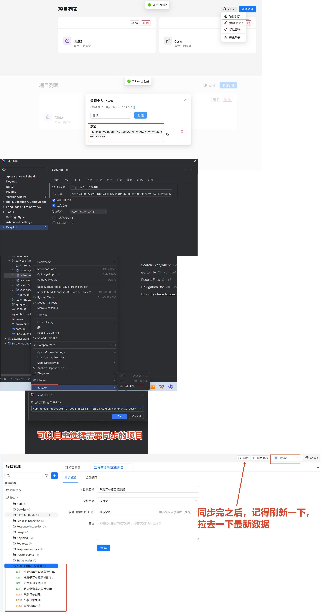

<div align="right">

**English** | [简体中文](./README.zh-CN.md)

</div>

# ApiMocktle

An IntelliJ IDEA plugin that extracts APIs from source code and syncs them to
[ApiMocktle](https://github.com/xiaohuiduan/ApiMocktle).

## Requirements

| Item | Version |
|------|---------|
| IntelliJ IDEA | 2026.2+ (build 262+) |
| JDK | 25+ |

## Installation

1. Download `ApiMocktle-x.x.x.zip` from the [Releases](https://github.com/xiaohuiduan/easy-yapi/releases) page
   (or `build/distributions/` for a local build)
2. IDEA → Settings → Plugins → ⚙️ → Install Plugin from Disk
3. Select the zip file and restart the IDE

## Setup

This plugin works together with [ApiMocktle](https://github.com/xiaohuiduan/ApiMocktle) and
**must** be used with it.



Configure it at **Settings → Tools → ApiMocktle → Export to ApiMocktle**: enter your server
address and personal access token.

## Features

### Export APIs to ApiMocktle

- Parse API endpoints from **Java / Kotlin** source code
- Authenticate with a **personal token** — no per-module configuration
- Choose which endpoints to export in a preview dialog before uploading
- Creates categories automatically, detects duplicate endpoints, and confirms updates
- Four update modes: always update / never update / always ask / update only if changed
- Progress is reported in a notification; the plugin never uploads silently

### API Dashboard

A built-in tool window for browsing and inspecting APIs:

- Browse endpoints by class in a tree
- Filter by path, name, or HTTP method
- Inspect path params, query params, headers, form params, request body, and response body
- Click an endpoint to jump to its source code
- Endpoint details are **read-only** (request execution was removed in 3.0.0)

### Field conversion

- Convert class fields to **JSON** or **JSON5**
- The result is copied to the clipboard

### Mock Agent

- Auto-inject the Mock Agent into Spring Boot run configurations (`-javaagent`)
- Intercepts Feign / MyBatis calls and returns mock data
- Agent status is shown in the Dashboard status bar

## Supported frameworks

| Category | Support |
|----------|---------|
| Language | Java, Kotlin |
| Web framework | Spring MVC, Spring Cloud OpenFeign |
| Validation | javax.validation / Jakarta Validation |
| Serialization | Jackson, Gson |
| API annotations | Swagger 2 / OpenAPI 3 |

> **Note**: JAX-RS, gRPC, Scala/Groovy adapters, and API Search Everywhere were **removed in
> 3.0.0** — see [CHANGELOG.md](./CHANGELOG.md).

## Usage

### Export to ApiMocktle

1. Configure the server address and personal token in the settings page
2. Right-click a controller file, class, or method → **Export to ApiMocktle**
3. Review the endpoints to export in the dialog and confirm
4. APIs are synced automatically; a notification reports the result

### Open the dashboard

**Tools → Open API Dashboard**, or click the **API Dashboard** tab at the bottom of the IDE.

### Convert fields to JSON

Right-click inside a class → **ApiMocktle → To JSON / To JSON5**.

## Configuration

The plugin uses a layered configuration system:

| Priority | Source | Description |
|----------|--------|-------------|
| Highest | Local file | `.easy.api.config` in the project root |
| | Extension | Built-in extension configurations |
| | Runtime | Runtime-provided configuration |
| Lowest | Built-in | Default configuration |

The rule engine supports Groovy scripts, regular expressions, annotation expressions, and
more. See [`docs/apimocktle-script-reference.md`](./docs/apimocktle-script-reference.md).

## Development

### Requirements

- JDK 25
- IntelliJ IDEA 2026.2+

### Build

```bash
# Compile and package
./gradlew clean buildPlugin

# Run a sandbox IDE instance
./gradlew runIde

# Run tests
./gradlew test
```

Local builds use `local.properties` (gitignored) to switch between a locally installed IDE
and a downloaded platform. On Windows, `build-local.bat` pins `JAVA_HOME` to the IDEA JBR.

## Architecture

```
IDE layer (Actions, Dashboard, Line Markers)
    ↓
Export layer (ExportOrchestrator → ClassExporter → YapiExporter)
    ↓
Core services (RuleEngine, ConfigReader, ApiIndex, HttpClient)
    ↓
PSI analysis (TypeResolver, DocHelper, AnnotationHelper)
```

- **ClassExporter** — extracts the `ApiEndpoint` model from a PSI class
- **YapiExporter** — formats and uploads to the YAPI server
- **ExportOrchestrator** — coordinates the full scan-to-export flow
- **RuleEngine** — evaluates rule expressions to customize parsing behavior

More detail in [`.trellis/spec/backend/`](./.trellis/spec/backend/index.md).

## Troubleshooting

| Symptom | Cause / fix |
|---------|-------------|
| UI stays Chinese after switching the IDE to English | The Language Pack plugin version must match the IDE build. A mismatched pack falls back to English UI while the JVM locale stays `zh_CN`. Check `idea.log` for `AppStarter - locale=...` |
| Export fails with "server address or token not configured" | Fill in both fields in **Settings → Tools → ApiMocktle** |
| Encoding problems with Chinese text | The bundles are UTF-8 without BOM; the plugin reads them through `DynamicBundle` |

## Acknowledgement

1. This project is based on [tangcent/easy-yapi](https://github.com/tangcent/easy-yapi). We
   removed features unrelated to ApiMocktle, translated the UI into Chinese, and simplified
   the token-based sync flow.
2. Thanks to the mimo 100T program for the free 200M credits package.
3. Thanks to DeepSeek for making this project possible at a very low cost.
