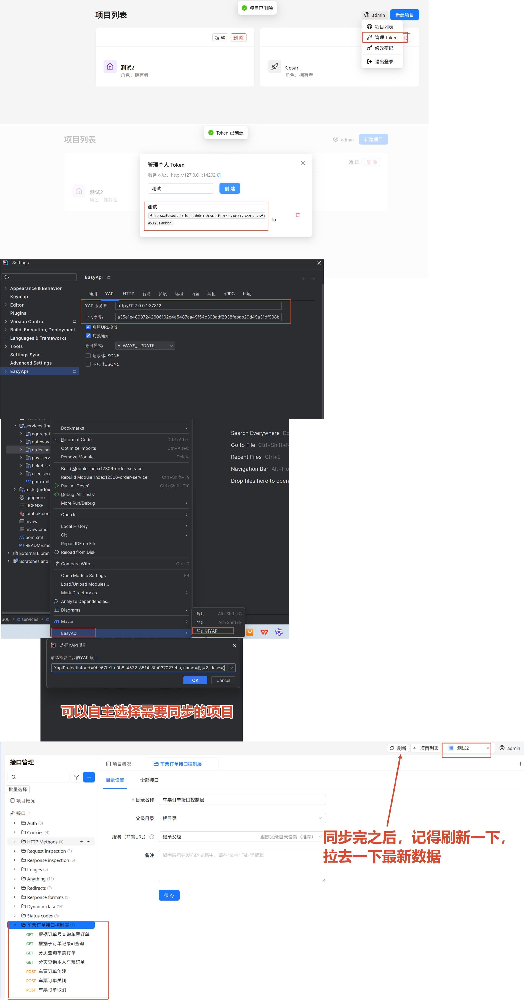

<div align="right">

[English](./README.md) | **简体中文**

</div>

# ApiMocktle

一个 IntelliJ IDEA 插件，从源码提取 API 并同步到 [ApiMocktle](https://github.com/xiaohuiduan/ApiMocktle)。

## 环境要求

| 项目 | 版本 |
|------|------|
| IntelliJ IDEA | 2026.2+（build 262+）|
| JDK | 25+ |

## 安装

1. 从 [Releases](https://github.com/xiaohuiduan/easy-yapi/releases) 页面下载 `ApiMocktle-x.x.x.zip`
   （本地构建则在 `build/distributions/` 下）
2. IDEA → Settings → Plugins → ⚙️ → Install Plugin from Disk
3. 选择 zip 文件，重启 IDEA

## 配置

该插件必须结合 [ApiMocktle](https://github.com/xiaohuiduan/ApiMocktle) 共同使用。



在 **Settings → Tools → ApiMocktle → 导出到 ApiMocktle** 中填写服务器地址和个人令牌。

## 功能

### API 导出到 ApiMocktle

- 从 **Java / Kotlin** 源码解析 API 端点
- 使用**个人令牌**认证，无需为每个模块单独配置
- 上传前在预览对话框中勾选要导出的端点
- 自动创建分类、检测重复接口、确认更新
- 四种更新模式：始终更新 / 不更新 / 每次询问 / 仅在内容变更时更新
- 通过通知汇报进度，不会静默上传

### API 仪表盘

内置工具窗口，用于浏览和查看 API：

- 按类浏览接口树
- 按路径、名称或 HTTP 方法过滤
- 查看路径参数、查询参数、请求头、表单参数、请求体、响应体
- 点击端点可跳转到源码
- 端点详情为**只读**（请求执行功能已在 3.0.0 移除）

### 字段转换

- 将类字段转换为 **JSON** 或 **JSON5**
- 结果复制到剪贴板

### Mock Agent

- 向 Spring Boot 运行配置自动注入 Mock Agent（`-javaagent`）
- 拦截 Feign / MyBatis 调用并返回模拟数据
- Agent 状态显示在仪表盘状态栏中

## 支持的框架

| 类别 | 支持 |
|------|------|
| 语言 | Java、Kotlin |
| Web 框架 | Spring MVC、Spring Cloud OpenFeign |
| 校验 | javax.validation / Jakarta Validation |
| 序列化 | Jackson、Gson |
| API 注解 | Swagger 2 / OpenAPI 3 |

> **注意**：JAX-RS、gRPC、Scala/Groovy 适配器、API Search Everywhere 均已在 **3.0.0 移除**，
> 详见 [CHANGELOG.md](./CHANGELOG.md)。

## 使用方法

### 导出到 ApiMocktle

1. 在设置页配置服务器地址和个人令牌
2. 右键控制器文件、类或方法 → **导出到 ApiMocktle**
3. 在对话框中确认要导出的端点
4. API 自动同步，并通过通知汇报结果

### 打开仪表盘

**Tools → 打开API仪表盘**，或点击 IDE 底部的 **API Dashboard** 标签。

### 字段转换为 JSON

在类中右键 → **ApiMocktle → 转JSON / 转JSON5**。

## 配置说明

插件使用分层配置系统：

| 优先级 | 来源 | 说明 |
|--------|------|------|
| 最高 | 本地文件 | 项目根目录 `.easy.api.config` |
| | 扩展 | 内置扩展配置 |
| | 运行时 | 运行时提供的配置 |
| 最低 | 内置 | 默认配置 |

规则引擎支持 Groovy 脚本、正则表达式、注解表达式等语法。
详见 [`docs/apimocktle-script-reference.md`](./docs/apimocktle-script-reference.md)。

## 开发

### 环境要求

- JDK 25
- IntelliJ IDEA 2026.2+

### 构建

```bash
# 编译并打包
./gradlew clean buildPlugin

# 运行沙箱 IDEA 实例
./gradlew runIde

# 运行测试
./gradlew test
```

本地构建通过 `local.properties`（已 gitignore）在本机安装的 IDE 与下载的平台之间切换。
Windows 下 `build-local.bat` 会把 `JAVA_HOME` 固定到 IDEA 自带的 JBR。

## 架构

```
IDE 层 (Actions, Dashboard, Line Markers)
    ↓
导出层 (ExportOrchestrator → ClassExporter → YapiExporter)
    ↓
核心服务 (RuleEngine, ConfigReader, ApiIndex, HttpClient)
    ↓
PSI 分析 (TypeResolver, DocHelper, AnnotationHelper)
```

- **ClassExporter** — 从 PSI 类提取 `ApiEndpoint` 模型
- **YapiExporter** — 格式化并上传至 YAPI 服务端
- **ExportOrchestrator** — 协调从扫描到导出的完整流程
- **RuleEngine** — 评估规则表达式，自定义解析行为

更多细节见 [`.trellis/spec/backend/`](./.trellis/spec/backend/index.md)。

## 常见问题

| 现象 | 原因 / 处理 |
|------|------------|
| IDE 切成英文后界面仍是中文 | 语言包插件版本必须与 IDE build 匹配。版本不匹配时界面回退英文，但 JVM locale 仍是 `zh_CN`。可在 `idea.log` 中查看 `AppStarter - locale=...` |
| 导出失败，提示"服务器地址或个人令牌未配置" | 在 **Settings → Tools → ApiMocktle** 中把两个字段都填上 |
| 中文出现乱码 | 资源包为 UTF-8 无 BOM，插件通过 `DynamicBundle` 读取，不应出现乱码；若出现请检查文件编码 |

## 致谢

1. 本项目在 [tangcent/easy-yapi](https://github.com/tangcent/easy-yapi) 的基础上改造，
   移除了与 ApiMocktle 不相关的功能，将界面翻译为中文，并简化了基于令牌的同步流程。
2. 感谢 mimo 100T 计划提供的免费 2 亿 credits 套餐。
3. 感谢 DeepSeek，让本项目得以极低成本完成。
